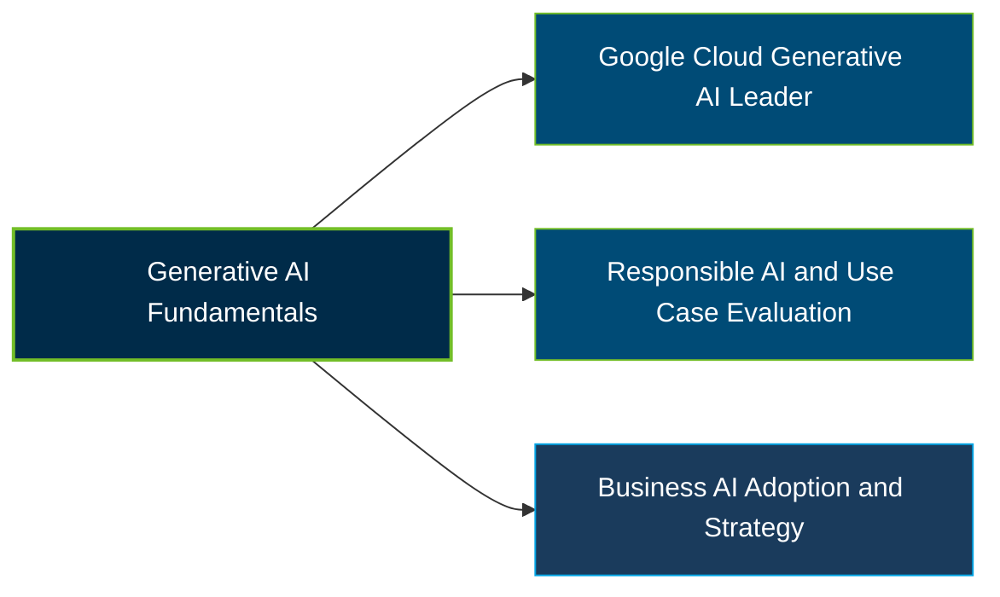

# Google Generative AI Leader Certification Exam Guide

A dedicated, comprehensive study guide and AI strategy reference repository for candidates preparing for the **Google Cloud Generative AI Leader Certification Exam**.

---

## Exam Overview

The Google Cloud Generative AI Leader certification validates business-level knowledge of generative AI, Google Cloud AI offerings, responsible adoption, and opportunities to use AI to support organizational goals.

- **Exam Format**: Multiple-choice questions; online-proctored or onsite-proctored exam
- **Target Audience**: Business leaders, managers, strategists, product leaders, and professionals exploring generative AI adoption
- **Prerequisites**: None; the certification is designed for candidates with or without hands-on technical experience

---

## Core Exam Domains & Knowledge Areas

### 1. Fundamentals of gen AI

- Understanding generative AI, foundation models, large language models, and multimodal models.
- Identifying business use cases, machine learning approaches, and the generative AI lifecycle.
- Understanding data quality, data types, and Google’s foundation models, including Gemini, Gemma, Imagen, and Veo.

### 2. Google Cloud’s gen AI offerings

- Understanding Google Cloud’s AI ecosystem, infrastructure, and enterprise-ready AI platform.
- Identifying business use cases for Gemini, Google Workspace AI, and customer engagement offerings.
- Understanding tools for developers, retrieval-augmented generation (RAG), and AI agent development.

### 3. Techniques to improve gen AI model output

- Recognizing foundation model limitations, including hallucinations, bias, and knowledge gaps.
- Applying prompt engineering, grounding, RAG, and fine-tuning concepts.
- Understanding model evaluation, monitoring, and human-in-the-loop practices.

### 4. Business strategies for a successful gen AI solution

- Identifying business opportunities and evaluating generative AI use cases.
- Applying responsible AI, security, privacy, and governance considerations.
- Planning adoption, measuring business value, and supporting organizational transformation.

---

## Certification Path

This is a suggested learning progression, not an official prerequisite or mandatory certification sequence.

---

## Recommended Practice & Study Resources

Combine official Google Cloud training with practical evaluation of generative AI use cases, model capabilities, and responsible adoption strategies.

- **CertsGate**: Explore [Google Generative AI Leader exam preparation resources](https://certsgate.com/exams/google/generative-ai-leader) for supplementary study materials and practice questions.
- **Google Cloud AI Documentation**: Review [Google Cloud’s generative AI documentation](https://cloud.google.com/vertex-ai/generative-ai/docs) to explore model capabilities, prompt design, grounding, and responsible AI practices.
